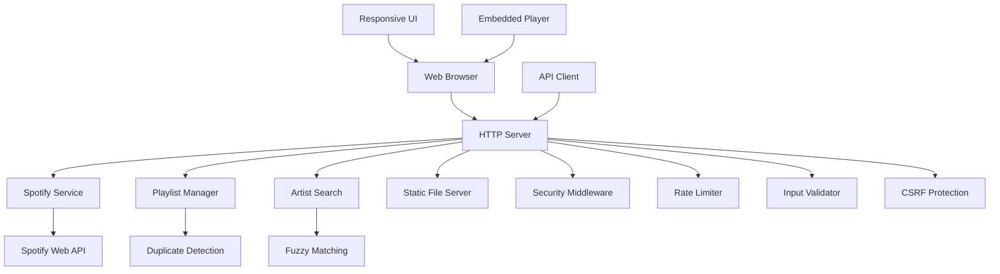

# Design Document

## Overview

go-listen builds on the current scaffold for Go starter projects.
Users can search for artists and automatically add their top 5 songs to designated `incoming` playlists on Spotify.
The application provides a responsive web interface and a REST API to manage artists.
It includes fuzzy artist search, duplicate detection, playlist management, and logs of all operations.
The design follows recommended practices for web security.

The application uses the `zmb3/spotify` Go library to integrate with the Spotify Web API.
It preserves the current architecture with Cobra and Viper and adds HTTP server capabilities.

## Architecture

### High-Level Architecture



### Component Layers

1. **Presentation Layer**
   - Responsive interface with HTML, CSS, and JS with mobile-first design
   - Searchable dropdown for playlist selection
   - Embedded Spotify player integration
   - REST API endpoints for programmatic access
   - Real-time feedback and confirmation messages

2. **Application Layer**
   - HTTP handlers and middleware
   - Request validation and sanitization
   - Rate limiting and security controls
   - CSRF protection for state-changing operations
   - Input validation against injection attacks

3. **Business Logic Layer**
   - Spotify service wrapper with top 5 track retrieval
   - Fuzzy artist search and matching
   - Management of playlists from the `Incoming` folder
   - Duplicate detection with timestamps
   - Override functionality for duplicate handling

4. **Integration Layer**
   - Client for the Spotify Web API (`zmb3/spotify`) with Client Credentials flow
   - Configuration management (Viper)
   - Structured log output with multiple severity levels

## Components and Interfaces

### Web Server Component

```go
type Server struct {
    router     *http.ServeMux
    spotify    SpotifyService
    config     *config.Config
    logger     *logrus.Logger
    rateLimiter RateLimiter
}

type ServerConfig struct {
    Port         int
    StaticDir    string
    SpotifyConfig SpotifyConfig
    RateLimit    RateLimitConfig
}
```

### Spotify Service Interface

```go
type SpotifyService interface {
    SearchArtist(query string) (*Artist, error)
    GetArtistTopTracks(artistID string) ([]Track, error)
    GetUserPlaylists(folderName string) ([]Playlist, error)
    AddTracksToPlaylist(playlistID string, trackIDs []string) error
    CheckTracksInPlaylist(playlistID string, trackIDs []string) ([]bool, error)
}

type SpotifyClient struct {
    client *spotify.Client
    logger *logrus.Logger
}
```

### Artist Search Component

```go
type ArtistSearcher interface {
    FindBestMatch(query string) (*Artist, float64, error)
}

type FuzzyArtistSearcher struct {
    spotify SpotifyService
    logger  *logrus.Logger
}
```

### Playlist Manager Component

```go
type PlaylistManager interface {
    AddArtistToPlaylist(artistName, playlistID string, force bool) (*AddResult, error)
    GetIncomingPlaylists() ([]Playlist, error)
    GetTop5Tracks(artistID string) ([]Track, error)
    FilterPlaylistsBySearch(playlists []Playlist, searchTerm string) []Playlist
}

type PlaylistService struct {
    spotify   SpotifyService
    duplicate DuplicateDetector
    logger    *logrus.Logger
}
```

### Duplicate Detection Component

```go
type DuplicateDetector interface {
    CheckDuplicates(playlistID string, tracks []Track) (*DuplicateResult, error)
    CheckArtistInPlaylist(playlistID, artistID string) (*DuplicateResult, error)
}

type DuplicateResult struct {
    HasDuplicates   bool      `json:"has_duplicates"`
    DuplicateTracks []Track   `json:"duplicate_tracks"`
    LastAdded       time.Time `json:"last_added"`
    ArtistName      string    `json:"artist_name"`
    Message         string    `json:"message"`
}
```

## Data Models

### Core Models

```go
type Artist struct {
    ID       string `json:"id"`
    Name     string `json:"name"`
    URI      string `json:"uri"`
    Genres   []string `json:"genres"`
}

type Track struct {
    ID       string `json:"id"`
    Name     string `json:"name"`
    URI      string `json:"uri"`
    Artists  []Artist `json:"artists"`
    Duration int `json:"duration_ms"`
}

type Playlist struct {
    ID          string `json:"id"`
    Name        string `json:"name"`
    URI         string `json:"uri"`
    TrackCount  int    `json:"track_count"`
    EmbedURL    string `json:"embed_url"`
    IsIncoming  bool   `json:"is_incoming"`
}

type AddResult struct {
    Success       bool     `json:"success"`
    Artist        Artist   `json:"artist"`
    TracksAdded   []Track  `json:"tracks_added"`
    Playlist      Playlist `json:"playlist"`
    WasDuplicate  bool     `json:"was_duplicate"`
    Message       string   `json:"message"`
}
```

### Models for API Requests and Responses

```go
type AddArtistRequest struct {
    ArtistName string `json:"artist_name" validate:"required,min=1,max=100"`
    PlaylistID string `json:"playlist_id" validate:"required"`
    Force      bool   `json:"force"`
}

type APIResponse struct {
    Success bool        `json:"success"`
    Data    interface{} `json:"data,omitempty"`
    Error   string      `json:"error,omitempty"`
}

type PlaylistSearchRequest struct {
    SearchTerm string `json:"search_term" validate:"max=100"`
}

type WebUIResponse struct {
    Success     bool        `json:"success"`
    Message     string      `json:"message"`
    Data        interface{} `json:"data,omitempty"`
    IsDuplicate bool        `json:"is_duplicate,omitempty"`
    LastAdded   *time.Time  `json:"last_added,omitempty"`
}
```

## Error Management

### Error Types

```go
type AppError struct {
    Type    ErrorType `json:"type"`
    Message string    `json:"message"`
    Code    int       `json:"code"`
    Cause   error     `json:"-"`
}

type ErrorType string

const (
    ErrorTypeValidation ErrorType = "validation"
    ErrorTypeSpotify   ErrorType = "spotify"
    ErrorTypeNotFound  ErrorType = "not_found"
    ErrorTypeRateLimit ErrorType = "rate_limit"
    ErrorTypeInternal  ErrorType = "internal"
)
```

### Error Management Strategy

1. **Input Validation Errors**: Return 400 Bad Request with validation details
2. **Spotify API Errors**: Map to appropriate HTTP status codes (401, 403, 429, 500)
3. **Not Found Errors**: Return 404 with helpful error messages
4. **Rate Limit Errors**: Return 429 with retry-after header
5. **Internal Errors**: Return 500 with generic message, log full details

## Test Strategy

### Unit Tests

1. **Service Layer Tests**
   - Mock the responses from the Spotify API
   - Test the algorithms for fuzzy comparison
   - Validate the logic for duplicate detection
   - Test scenarios for error management

2. **Handler Tests**
   - Test the management of HTTP requests and responses
   - Validate input sanitization
   - Test the behavior of rate limits
   - Test CSRF protection

3. **Integration Tests**
   - Test complete request flows
   - Validate the integration with the Spotify API
   - Test database operations (if added later)

### Test Structure

```go
// Example test structure
func TestSpotifyService_SearchArtist(t *testing.T) {
    tests := []struct {
        name     string
        query    string
        mockResp *spotify.SearchResult
        mockErr  error
        want     *Artist
        wantErr  bool
    }{
        // test cases
    }
}
```

### Security Tests

1. **Input Validation Tests**
   - SQL injection attempts
   - XSS payload tests
   - Path traversal attempts
   - Management of oversized input
   - Tests to sanitize artist names

2. **Rate Limits Tests**
   - Burst request tests
   - Sustained load tests
   - IP-based limiting validation
   - Rate limits for API endpoints

3. **CSRF Protection Tests**
   - Token validation for state-changing operations
   - Cross-origin request handling
   - Form submission protection

### Responsive Design Tests

1. **Mobile Device Tests**
   - Touch interface functionality
   - Viewport scaling and layout
   - Dropdown usability on small screens

2. **Cross-Device Tests**
   - Tablet layout adaptation
   - Use of desktop space
   - Responses to orientation changes

## Implementation Details

### HTTP Server Setup

The application will extend the current Cobra command structure with a new `serve` command that starts the HTTP server:

```go
var serveCmd = &cobra.Command{
    Use:   "serve",
    Short: "Start the web server",
    Run:   runServeCommand,
}

func runServeCommand(cmd *cobra.Command, args []string) {
    server := NewServer(conf)
    server.Start()
}
```

### Spotify Authentication

Since this is an internal service without user authentication requirements, we will use Spotify's Client Credentials flow for app-only authentication:

1. Configure the credentials for the Spotify app in environment variables
2. Obtain access token on startup for immediate service availability
3. Refresh the token automatically when the application needs a new token
4. Handle authentication errors without user intervention
5. No user authentication required for web interface or API access

### Web Interface Design

The responsive web interface will include:

1. **Main Search Interface**
   - Artist name input field with validation
   - Searchable dropdown for `Incoming` playlists
   - Add button with progress states
   - Override button for duplicate handling

2. **Embedded Player Section**
   - Dynamic Spotify embedded player
   - Updates based on selected playlist
   - Responsive sizing for different screen sizes

3. **Feedback and Status**
   - Display of success or error messages
   - Duplicate detection notifications with timestamps
   - Progress indicators for async operations

4. **Responsive Design Elements**
   - Mobile-first CSS with breakpoints
   - Touch-friendly interface elements
   - Adaptive layout for tablets and desktop
   - Responses to orientation changes

### Serve Static Files

The build will embed static files (HTML, CSS, JS) in the binary with Go's `embed` package:

```go
//go:embed static/*
var staticFiles embed.FS

func (s *Server) setupStaticRoutes() {
    staticHandler := http.FileServer(http.FS(staticFiles))
    s.router.Handle("/static/", staticHandler)
    s.router.HandleFunc("/", s.handleIndex)
}
```

### Rate Limits Implementation

Implement token bucket rate limits per IP address:

```go
type RateLimiter struct {
    visitors map[string]*rate.Limiter
    mu       sync.RWMutex
    rate     rate.Limit
    burst    int
}
```

### Logs Strategy

structured logs with different levels to meet requirement 6:
- INFO: Successful operations, artist additions, playlist selections
- WARN: Duplicate detections, rate limit hits, override usage
- ERROR: Spotify API errors, validation failures, search failures
- DEBUG: Detailed information about requests and responses, fuzzy comparison scores

Specific log output requirements:
- Log all artist search terms and matched results
- Log all song additions with playlist and track details
- Log the details of API requests and responses
- Log security events and suspicious activity
- Include timestamps and request correlation IDs

### Configuration Management

Extend current Viper configuration with web server settings:

```go
type Config struct {
    // Existing fields
    Username string
    
    // New web server fields
    Server ServerConfig
    Spotify SpotifyConfig
    Security SecurityConfig
}

type SpotifyConfig struct {
    ClientID     string
    ClientSecret string
    RedirectURL  string
}
```

### Key Design Decisions and Rationales

**No user authentication.** Requirement 9 specifies internal network use without complex authentication.
The application uses Spotify's Client Credentials flow only for API access.

**Responsive design.** Requirement 7 mandates compatibility across devices.
The design uses mobile-first adaptive layouts.

**Fuzzy artist search.** Fuzzy comparison accommodates variations in user input and improves search success rates compared with exact `string` comparison.

**Duplicate detection with override.** Requirement 4 specifies duplicate prevention and user control.
The design includes timestamps and a force override.

**Top 5 songs.** Requirement 1 limits retrieval and addition to each artist's top 5 songs.
This limit maintains playlist quality and prevents excessive song additions for users.

**Focus on the `Incoming` folder.** Requirement 2 specifies playlists from this folder.
The design filters playlists by folder.

**Embedded player.** Requirement 3 mandates immediate playback.
The design integrates Spotify's embedded player with dynamic playlist updates.

**Security.** Requirement 8 requires CSRF protection, input validation, rate limits, and sanitization throughout the application.

**Structured logs.** Requirement 6 specifies detailed operation records.
The design includes logs with multiple severity levels and records of specific events.

This design preserves compatibility with the current structure of the Go starter project.
It adds all components that the requirements specify to manage Spotify playlists.
