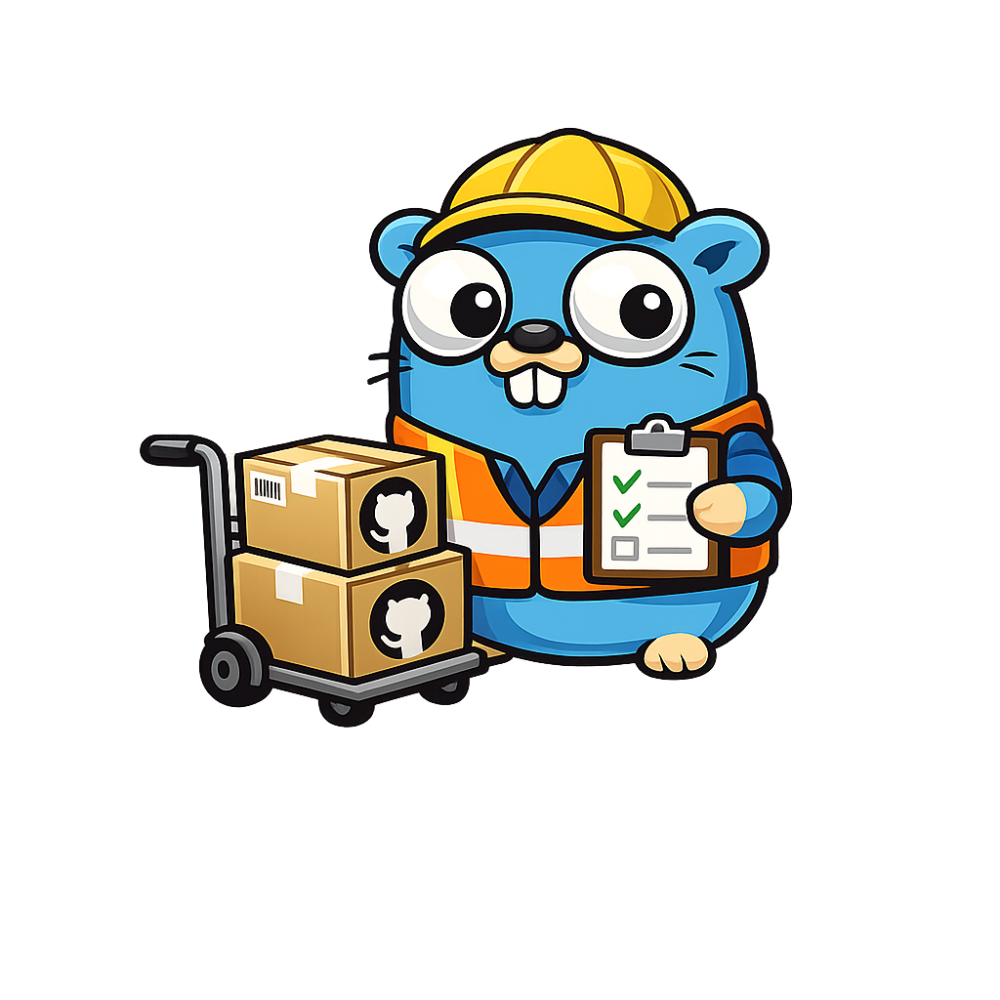

# go-sort-out-gh-actions




This tool detects archived, outdated, and EOL-runtime GitHub Actions in GHA workflows.
Optional features include notifications, automatic updates, reference pins, security scans, and GitHub issue creation.

## What it does

The tool scans workflows for GitHub Actions in `.github/workflows/**/*.yml` and `**/*.yaml`.
It checks whether maintainers archived any action in a `uses:` reference on GitHub.
Archived actions possibly contain security vulnerabilities, lack further updates, or fail with future GitHub changes.

The tool also detects outdated actions by comparison with each action's latest published version.
It validates references that use SemVer, release tags, SHAs, or branch names.
It can optionally update to the latest version with a SemVer reference, release tag, or immutable SHA.

## Features

- 🔍 **Automatic Detection**: Scans all workflow files in your repository
- 🚨 **Exit Codes**: Returns error code when the tool finds archived actions (CI/CD friendly)
- ⚠️ **Outdated Detection**: Optionally checks for outdated action versions
- ⏳ **Stale Detection**: Detects actions not updated in over a year or marked with GitHub deprecation warnings
- 📢 **Notifications**: Send alerts to configured webhooks when the tool detects archived actions
- 🐛 **Issue Creation**: Automatically create GitHub issues to track replacement tasks
- 🔧 **Flexible Configuration**: Environment variables, config files, and CLI flags
- 📊 **Verbose Output**: Detailed reporting of findings and API calls
- 🐳 **Docker Support**: Run via Docker or as native binary
- 🐳 **Pre-commit Support**: Run as a pre-commit check with either local Go toolchain or Docker
- ⚡ **Concurrent API Calls**: Parallel repository checks with rate limit protection
- 💾 **Smart Caching**: The tool looks up each action only once, even across multiple workflows
- 🔒 **Workflow Security Scan**: Detects risky triggers, poisoned-pipeline patterns, unsafe secret and artifact handling, excessive permissions, runner exposure, and unpinned actions

## Installation

### From GitHub Releases

Download the latest `go-sort-out-gh-actions` release from [the monogo releases page](https://github.com/toozej/monogo/releases).

### Use Go

```bash
go install github.com/toozej/monogo/apps/go-sort-out-gh-actions@main
```

### Docker

```bash
# Mount your current working directory so the tool can scan your workflows
docker run --rm -v $(pwd):/workspace -w /workspace ghcr.io/toozej/go-sort-out-gh-actions:latest

# With a GitHub token
docker run --rm -v $(pwd):/workspace -w /workspace -e GH_TOKEN=your_token ghcr.io/toozej/go-sort-out-gh-actions:latest

# With verbose output and outdated checking
docker run --rm -v $(pwd):/workspace -w /workspace -e GH_TOKEN=your_token ghcr.io/toozej/go-sort-out-gh-actions:latest outdated --verbose
```

## Usage

### Sub-commands

The tool provides several sub-commands for different check types:

```bash
# Check for archived actions
go-sort-out-gh-actions archived

# Check for outdated actions (not archived, but not latest version)
go-sort-out-gh-actions outdated

# Check for EOL/stale/deprecated actions
go-sort-out-gh-actions eol

# Run all checks (archived + EOL + outdated)
go-sort-out-gh-actions check

# Scan workflows for known security risks
go-sort-out-gh-actions scan
```

### Basic Usage

```bash
# Check all workflows in current repository for archived actions
go-sort-out-gh-actions archived

# Check a specific workflow file
go-sort-out-gh-actions archived --workflow .github/workflows/ci.yml

# Check a specific directory of workflow files
go-sort-out-gh-actions archived --workflows-dir ~/src/github/username/repo/.github/workflows

# Check multiple repos in a base directory (bulk scanning, say against all of your cloned repos)
go-sort-out-gh-actions archived --repos-dir ~/src/github

# Verbose output
go-sort-out-gh-actions archived --verbose

# Debug logging (includes rate limit info)
go-sort-out-gh-actions archived --debug

# Check for outdated actions with auto-update (pin to SHA)
go-sort-out-gh-actions outdated --update --pin

# Check for outdated actions with SemVer version strings
go-sort-out-gh-actions outdated --update --semver

# Apply a seven-day release age filter and exclude updates covered by Dependabot PRs
go-sort-out-gh-actions outdated --min-release-age-days 7 \
  --ignore-dependabot-prs --repository toozej/monogo --base-branch main

# Check for EOL/stale/deprecated actions
go-sort-out-gh-actions eol

# Check for EOL actions with custom stale threshold (180 days instead of default 365)
go-sort-out-gh-actions eol --stale-days 180

# Run all checks and auto-update EOL + outdated actions
go-sort-out-gh-actions check --write

# Fail only on high- or critical-severity security findings
go-sort-out-gh-actions scan --min-severity high

# Emit security findings for tooling
go-sort-out-gh-actions scan --output-format json
```

The `outdated` command has two optional filters for repositories that use Dependabot.
`--min-release-age-days` selects the highest stable SemVer release whose publication date meets the minimum age.
The default is `0`, which disables the age filter.
The filter excludes draft releases and prereleases.
It does not use tags without a published release date.
A pin to a newer published stable release does not cause a downgrade report.

`--ignore-dependabot-prs` excludes an update only when an open PR from `dependabot[bot]` covers that update.
The filter checks the target branch, changed workflow path, action path, and proposed version or SHA.

The PR must remove all uses of the reported old reference from that workflow.
An older proposed version or a PR for another workflow does not suppress the report.

Use `--repository owner/repo` to select the scanned repository.
Use `--base-branch` to select the target branch, or omit it to use the repository default branch.

This filter supports a local scan of one repository and requires permission to read pull requests.
API errors stop the filtered check with a non-zero exit status.

The `check-outdated` action provides the same filters through its `min-release-age-days`,
`ignore-dependabot-prs`, `repository`, and `base-branch` inputs.
The published container must contain a release of the app that supports these inputs.
This repository's weekly workflow runs the checked-out source with both filters enabled.

### Workflow security scanning

`scan` is an offline, rule-based check that returns a non-zero exit code when it reports a finding. It supports the same flags for local targets as the other commands: `--workflow`, `--workflows-dir`, and `--repos-dir`. Findings include a stable rule ID, severity, path, source line, and remediation; use `--output-format json` or `csv` for automation.

The built-in rules are small and composable. Register additional checks through the internal `securityscan.Rule` interface.
The rules cover dangerous event trust boundaries, poisoned-pipeline execution, and command and environment-file injection.
They cover token and deployment permissions, action and cache supply-chain risks, secret lifetime and scope, and checkout credential persistence.
They also cover artifact poisoning and leakage and exposure of runners or Docker hosts.

See [Workflow security scan coverage](SECURITY_SCAN.md) for the deduplicated matrix of rules and remediations and source references.
It also lists controls that a scan cannot verify from workflow YAML alone.

Use the reusable GitHub Action in another repository after checkout. It is offline and does not require a token:

```yaml
- uses: toozej/monogo/apps/go-sort-out-gh-actions/scan@main
  with:
    min-severity: high
```

### Path Expansion

All path inputs support `~` expansion to your home directory:

```bash
go-sort-out-gh-actions --workflows-dir ~/src/github/repo/.github/workflows
go-sort-out-gh-actions --repos-dir ~/src/github
```

### Authentication

Set the GitHub token with one of these methods (in order of priority):

1. `--token` flag
2. `GH_TOKEN` environment variable
3. `GITHUB_TOKEN` environment variable

```bash
# Using environment variable
export GH_TOKEN=your_github_token_here
go-sort-out-gh-actions

# Using CLI flag
go-sort-out-gh-actions --token your_github_token_here

# Using GitHub CLI (gh) to get a token automatically
export GH_TOKEN=$(gh auth token)
go-sort-out-gh-actions

# Or inline
go-sort-out-gh-actions --token $(gh auth token)
```

### Notifications

Configure one or more notification providers and enable them with the `--notify` flag. See [the Configuration Reference](CONFIG.md) for supported providers and full configuration options.

### Issue Creation

Automatically create GitHub issues when the tool finds archived actions:

```bash
go-sort-out-gh-actions --create-issue
```

### Configuration File

Create a `.env` file in your repository root:

```env
GH_TOKEN=your_github_token_here
SLACK_TOKEN=xoxb-...
SLACK_CHANNEL_ID=C12345678
CREATE_ISSUES=true
```

Use the `.env.` configuration file when you run go-sort-out-gh-actions by either:
1. `make local-run` or `make run` Make targets
2. `source .env` before you run `go-sort-out-gh-actions` if you run the local binary,
3. add the `--env-file` flag when you use Docker such as `docker run --env-file .env ...`

See [the Configuration Reference](CONFIG.md) for full configuration options

### GitHub Actions

This repository provides multiple container actions. The examples below track `main`. Tagged refs such as `@apps/go-sort-out-gh-actions/vX.Y.Z` pin the action metadata, while the metadata currently runs the latest published container image.

| Action | Description | Example Workflow |
|--------|-------------|------------------|
| `toozej/monogo/apps/go-sort-out-gh-actions@main` | Check for archived actions (default or root action) | [`example-archived-actions.yaml`](examples/workflows/example-archived-actions.yaml) |
| `toozej/monogo/apps/go-sort-out-gh-actions/check-archived@main` | Check for archived actions with notifications and issue creation | [`example-archived-actions-check.yaml`](examples/workflows/example-archived-actions-check.yaml), [`example-archived-actions-custom-stale.yaml`](examples/workflows/example-archived-actions-custom-stale.yaml) |
| `toozej/monogo/apps/go-sort-out-gh-actions/check-outdated@main` | Check for outdated action versions with optional auto-update | [`example-outdated-actions-check.yaml`](examples/workflows/example-outdated-actions-check.yaml), [`example-auto-update-actions.yaml`](examples/workflows/example-auto-update-actions.yaml), [`example-outdated-actions-semver.yaml`](examples/workflows/example-outdated-actions-semver.yaml) |
| `toozej/monogo/apps/go-sort-out-gh-actions/eol@main` | Check for EOL, stale, or deprecated actions | [`example-eol-actions-check.yaml`](examples/workflows/example-eol-actions-check.yaml), [`example-eol-actions-update.yaml`](examples/workflows/example-eol-actions-update.yaml), [`example-eol-actions-custom-stale.yaml`](examples/workflows/example-eol-actions-custom-stale.yaml) |
| `toozej/monogo/apps/go-sort-out-gh-actions/check@main` | Run all checks (archived + EOL + outdated) | [`example-check-all-actions.yaml`](examples/workflows/example-check-all-actions.yaml), [`example-check-all-with-write.yaml`](examples/workflows/example-check-all-with-write.yaml) |


### Pre-commit Hook

| Hook ID | Description | Example Usage |
|---------|-------------|---------------|
| `go-sort-out-gh-actions` | Check for archived GitHub Actions | See archived example below |
| `go-sort-out-gh-actions-eol` | Check for EOL GitHub Actions | See EOL example below |
| `go-sort-out-gh-actions-outdated` | Check for outdated GitHub Actions | See outdated example below |
| `go-sort-out-gh-actions-check` | Run all checks (archived, EOL, and outdated) | See check-all example below |
| `go-sort-out-gh-actions-docker` | Check for archived GitHub Actions (Docker) | See Docker archived example below |
| `go-sort-out-gh-actions-eol-docker` | Check for EOL GitHub Actions (Docker) | See Docker EOL example below |
| `go-sort-out-gh-actions-outdated-docker` | Check for outdated GitHub Actions (Docker) | See Docker outdated example below |
| `go-sort-out-gh-actions-check-docker` | Run all checks with Docker image | See Docker check-all example below |

Add to your `.pre-commit-config.yaml`:

```yaml
repos:
- repo: https://github.com/toozej/monogo
  rev: main
  hooks:
  # Check for archived GitHub Actions
  - id: go-sort-out-gh-actions
    args: [--verbose]

  # Check for EOL GitHub Actions
  - id: go-sort-out-gh-actions-eol
    args: [--verbose]

  # Check for outdated GitHub Actions
  - id: go-sort-out-gh-actions-outdated
    args: [--verbose]

  # Run all checks (archived, EOL, outdated)
  - id: go-sort-out-gh-actions-check
    args: [--verbose]
```

Or with the Docker-based hooks (no Go toolchain required):

```yaml
repos:
- repo: https://github.com/toozej/monogo
  rev: main
  hooks:
  # Check for archived GitHub Actions (Docker)
  - id: go-sort-out-gh-actions-docker
    args: [--verbose]

  # Check for EOL GitHub Actions (Docker)
  - id: go-sort-out-gh-actions-eol-docker
    args: [--verbose]

  # Check for outdated GitHub Actions (Docker)
  - id: go-sort-out-gh-actions-outdated-docker
    args: [--verbose]

  # Run all checks using Docker image
  - id: go-sort-out-gh-actions-check-docker
    args: [--verbose]
```

## Exit Codes

- `0`: Success - no archived, outdated, or stale actions found
- `1`: Error - archived, outdated, or stale actions found, or execution failed

## Example Output

### Archived Actions Only

```
$ go-sort-out-gh-actions archived --verbose

Found 3 workflow files
- .github/workflows/ci.yml (2 uses)
- .github/workflows/release.yml (1 uses)
Extracted 3 unique action references
- actions/checkout
- actions/setup-go
- docker/build-push-action

Checking 3 action repositories for archived status...

🚨 Found 1 archived GitHub Actions in 1 workflows:

📄 .github/workflows/ci.yml:
❌ actions/checkout

❌ Archived actions detected. Please replace them with actively maintained alternatives.
```

### With Outdated Check

```
$ go-sort-out-gh-actions check --verbose

Found 1 workflow files
- examples/workflows/example-archived-actions.yaml (9 uses)
Extracted 9 unique action references
- actions-rs/toolchain@v1
- actions/cache@v2
- actions/checkout@v4
Checking 9 action repositories for archived status...
Checking 5 non-archived action repositories for latest versions...

🚨 Found 4 archived GitHub Actions in 4 workflows:

📄 example-archived-actions.yaml:
❌ actions-rs/audit-check@v1
❌ actions-rs/cargo@v1
❌ actions-rs/clippy-check@v1
❌ actions-rs/toolchain@v1


⚠️ Found 2 outdated GitHub Actions in 2 uses:

📄 example-archived-actions.yaml:
⚠️ actions/cache@v2 (latest: v4.0.0)
⚠️ actions/checkout@v4 (latest: v4.1.0)

❌ Archived actions detected. Please replace them with actively maintained alternatives.
```

### With Stale Check

```
$ go-sort-out-gh-actions eol --verbose

Checking 5 non-archived action repositories for stale/deprecated status...

⏳ Found 1 stale/deprecated GitHub Actions in 1 uses:

📄 ci.yml:
⏳ some-action/old-action@v1 (DEPRECATED: This action uses Node.js 16 which is deprecated)
⏳ another/stale-action@v2 (not updated since 2021-05-10)

⏳ Stale or deprecated actions detected. Consider replacing them with actively maintained alternatives.
```

### Major Version Tag Handling

When you use the `outdated` sub-command, the tool intelligently handles major version tags (for example `v2`):

For `action@v2` and a latest release of `v2.3.3`, the tool compares commit SHAs.

If the major version tag (`v2`) and latest version (`v2.3.3`) point to the same commit, the tool does **not** mark it outdated.
If these tags point to different commits, the tool **marks** the major version tag outdated because a new patch exists.

This allows you to use major version tags (recommended practice) without false positives.

```
# action@v2 points to same commit as v2.3.3 (same SHA) - NOT outdated
# action@v2 but latest is v3.0.0 (different major) - IS outdated
```

### Debug Mode (Rate Limit Info)

When you run with `--debug`, the tool logs information about rate limits from the GitHub API:

```
$ go-sort-out-gh-actions archived --debug
DEBU[0000] GitHub API rate limit: limit=5000 remaining=4998 used=2 reset=2026-05-04T22:00:00Z resource=core
```

## Quick Demo

To quickly see how this tool works, run the demo which checks an example workflow with archived and outdated actions:

```bash
# Build and run against example workflow (includes outdated checking)
make demo

# Or run manually after building
make local-build
./out/go-sort-out-gh-actions outdated --workflow examples/workflows/example-archived-actions.yaml --verbose

# Run archived check
./out/go-sort-out-gh-actions archived --workflow examples/workflows/example-archived-actions.yaml --verbose

# Run all checks
./out/go-sort-out-gh-actions check --workflow examples/workflows/example-archived-actions.yaml --verbose

# Using GitHub CLI for authentication
./out/go-sort-out-gh-actions outdated --workflow examples/workflows/example-archived-actions.yaml --verbose --token $(gh auth token)
```

The example workflow at `examples/workflows/example-archived-actions.yaml` contains:
- **Archived actions** (4 from `actions-rs/*` organization): `actions-rs/toolchain`, `actions-rs/cargo`, `actions-rs/clippy-check`, `actions-rs/audit-check`
- **Current actions** (GitHub official): `actions/checkout@v6`, `actions/setup-go@v6`, `github/codeql-action`, `actions/upload-artifact@v4`, `actions/download-artifact@v4`
- **Outdated but not archived**: `actions/cache@v2` (latest: v5.x), `actions/download-artifact@v4` (latest: v8.x), `actions/upload-artifact@v4` (latest: v7.x)
