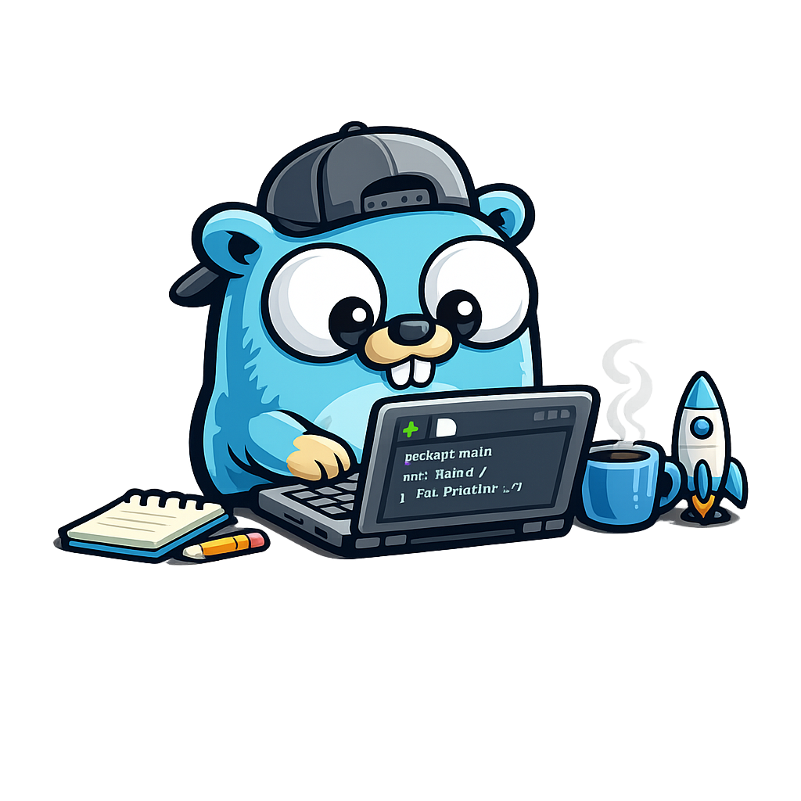

# golang-starter




Golang starter template

## Features of this starter template

- Common Go layout conventions, with README files that explain where code belongs
- Cobra for CLI commands and Logrus for logs
- GoDotEnv and Env libraries to read config files, already integrated and ready for extension
- GoReleaser to build Docker images and most standard package types across Linux, macOS, and Windows
- Automatically generated manpages and shell completions
- A Makefile to build, deploy, test, and update with Docker or a local Go toolchain
- A Compose project to host the Dockerized Go project, with optional support for Go web services
- Scripts to simplify template use and update Go when a new version becomes available
- A Dev Container with extensions for Go in VS Code and the [llm](https://llm.datasette.io/) tool and plugins, preconfigured for GitHub Copilot
- Built-in security scans, vulnerability warnings, and automatic updates through Dependabot and GitHub Actions
- Automatically generated documentation
- Pre-commit hooks for format, lint, and security checks

The `docker_signs` feature in GoReleaser signs Docker images with Cosign v3 and keyless OIDC certificates from GitHub Actions.
The recommended verification method uses `cosign verify` with `--certificate-identity-regexp` and `--certificate-oidc-issuer https://token.actions.githubusercontent.com`.
Do not use `--key` for this keyless verification.

## Changes required to use this starter template

Generate a [GitHub token with fine-grained permissions](https://github.com/settings/tokens?type=beta).
The repository uses it as `GITHUB_TOKEN`. GitHub Actions secrets use it as `GH_TOKEN`.
Grant read and write permissions for these resources:

- Actions
- Attestations
- Code scanning alerts
- Commit statuses
- Contents
- Dependabot alerts
- Dependabot secrets
- Deployments
- Environments
- Issues
- Pages
- `Pull requests`
- Repository security advisories
- Secret scanning alerts
- Secrets
- Webhooks
- Workflows

Run `use_starter.sh` to rename project files, generate Cosign artifacts, and gather and upload secrets to GitHub Actions:

```bash
./scripts/use_starter.sh $NEW_PROJECT_NAME_GOES_HERE
```

To use a different GitHub username:

```bash
./scripts/use_starter.sh $NEW_PROJECT_NAME_GOES_HERE $GITHUB_USERNAME_GOES_HERE
```

### Configure Quay.io

Create the new repository in Quay.io.
Repositories on Docker Hub and GitHub Container Registry appear automatically on the first image publication.
The `use_starter.sh` script automates Quay.io repository creation and robot permissions through `scripts/create_quay_repo.sh`.
This requires a Quay.io `OAuth 2.0 Access Token`.
Store it as `QUAY_OAUTH_TOKEN` in `.env` and GitHub Actions secrets.

1. Log in to [quay.io](https://quay.io).
2. Open `Account Settings`, or `Organization Settings` for repositories that an organization owns.
3. Select `Applications` in the left sidebar.
4. Select `Create New Application`.
5. Give the application a name, for example `repo-automation`.
6. Select the new application.
7. Select `Generate Token` in the left sidebar.
8. Select `Create Repositories` (`repo:create`) and `Administer Repositories` (`repo:admin`).
9. Select `Generate Access Token`.
10. Copy the token.
11. Save it as `QUAY_OAUTH_TOKEN` in `.env`.

`QUAY_OAUTH_TOKEN` differs from `QUAY_TOKEN`, the robot account password for Docker login.
The OAuth token belongs to a user or organization and permits API operations.
The robot token authenticates image pushes and pulls.

Robot account usernames use the format `namespace+robotname`, for example `toozej+github_builder`.
If `QUAY_USERNAME` uses this format, `create_quay_repo.sh` automatically extracts the namespace and robot name.

### Publish GitHub packages

1. Navigate to `https://github.com/users/$USERNAME/packages/container/$REPO/settings`.
2. Find `Danger Zone`.
3. Change the visibility of built packages to public.

## Changes required to update the Go version

Run `make update-golang-version`.
