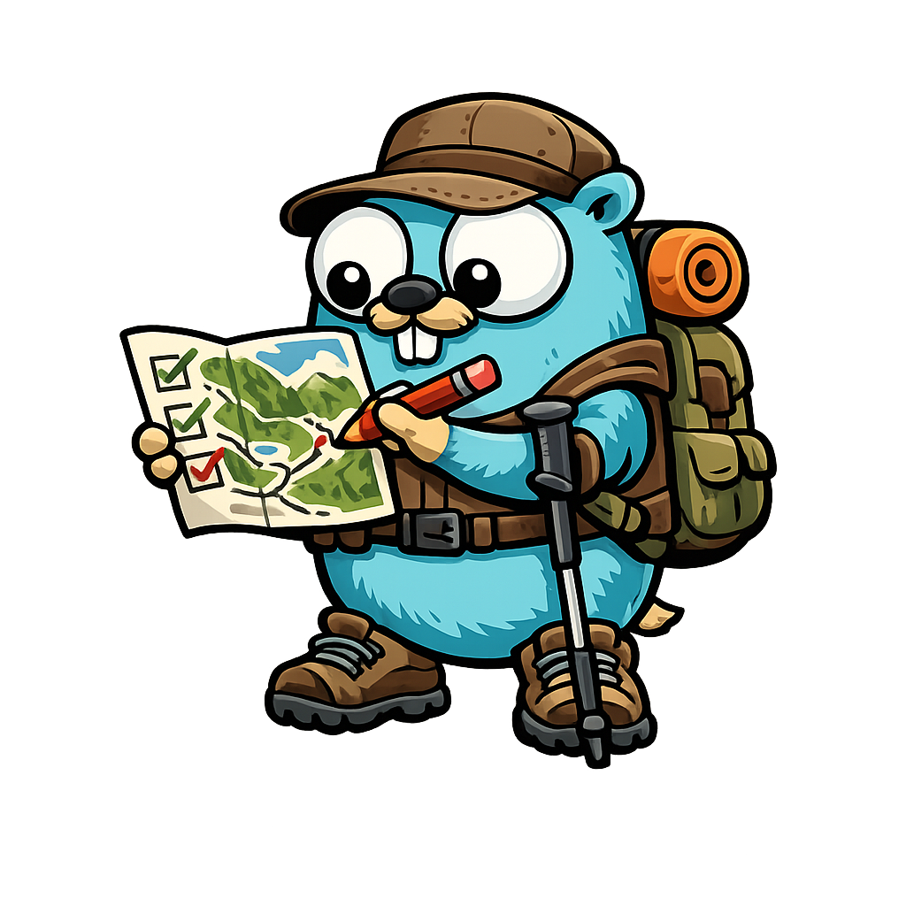

# trails-completionist




This Go application parses a list of trails and displays it in a searchable HTML table to track trail completion.
It optionally converts a directory of TCX trail files to GPX to simplify input.

## Local demo

Run the complete demo from the repository root:

```sh
./apps/trails-completionist/demo.sh
```

The script builds the app and downloads the Portland OSM extract and official city boundary.
It processes both included example inputs and listens on **0.0.0.0:3000** by default.

Open the page at **http://127.0.0.1:3000** on the host computer.
From another LAN computer, open `http://HOST-LAN-IP:3000` with the host computer's LAN address.

The wildcard address includes all IPv4 interfaces. It does not restrict clients to private IP ranges.
Place GPX files in `apps/trails-completionist/tracks/` before you run the demo.

The script processes nested directories and converts TCX activities to GPX when present.
An empty tracks directory still produces the inventory demo.

Press `Ctrl+C` to stop the server.

The first OSM download is approximately 153 MiB. Later runs reuse downloaded data and the parsed OSM cache.
Results remain in `out/trails-completionist-demo/`: `checklist.md`, `trails.html`, and `osm-audit.json`.
The `data/` subdirectory contains the downloaded extract and boundary.
Go, make, curl, gzip, and Python 3 must be available.

```sh
# The root Make target also builds the app and runs the demo.
make demo APP=trails-completionist

# Limit the demo to the host computer.
SERVE_ADDRESS=127.0.0.1:3000 make demo APP=trails-completionist

# Use a specific LAN interface and port.
./apps/trails-completionist/demo.sh --listen-address 192.168.1.20:3000

# Generate files without starting a server.
./apps/trails-completionist/demo.sh --no-serve

# Use another activity directory or download fresh data.
./apps/trails-completionist/demo.sh --tracks-dir /path/to/activities --refresh
```

Use `--output-dir DIR` to choose another output directory. Relative custom paths resolve from your current directory.
`--listen-address HOST:PORT` overrides `SERVE_ADDRESS` for the demo.

The app's normal `serve` command defaults to `127.0.0.1:3000`.
Use `--serveAddress 0.0.0.0:3000` or `SERVE_ADDRESS` to enable LAN access outside the demo.

If LAN access still fails, check whether the host firewall permits inbound TCP connections on the configured port.
The script also works when invoked by its absolute path from another directory.

Run `./apps/trails-completionist/demo.sh --help` to list all options.

## 🚀 Features
- Responsive list and card views, with cards as the default on phones
- Progress totals and completion filters
- Park, type, source, status, OSM match, and distance filters
- Fuzzy search and named search fields
- Numeric distance sorting and sorting by recent completion
- Browser-saved manual completion changes and editable completion dates
- CSV export of all records that match the current filters
- System, light, and dark themes
- Pagination for large inventories, keyboard controls, and trail details

## 🔍 Search Examples
- `completed: yes` - Show only completed trails
- `park name: Forest Park` - Trails in Forest Park
- `Moderate yes` - Moderate trails that you completed
- `5 miles` - Trails with "5" in their length

## 🛠️ Technology Stack
- Go
- HTML5
- CSS3 (with CSS Variables for themes)
- Vanilla JavaScript

## 🌐 Webpage Usage

Search by trail or park name. Use `/` to focus the search field. Use `Escape` to clear the search.
Named fields still work, such as `park name: Forest Park`, `completed: yes`, and `osm match: missing`.
Use quotes when a field value contains another field name, such as `name:"Trail park: connector"`.

Select **All trails**, **To explore**, or **Completed** to filter by progress.
Open **Filters** to select a park, type, source, source status, OSM match, or distance range.
Filters apply to the entire collection. Each page displays 24, 48, or 96 records.
The view buttons switch between a table and cards. Phones use cards automatically unless you select another view.

Open a trail's details to inspect its source, status, OSM match, record ID, and completion date.
Details include links to the trail website and source when available.
Pages generated with line geometry also provide an OpenStreetMap location link.
Checklist files do not retain line geometry, so `generate-html` cannot add location links from a checklist alone.

Select a completion checkbox to record or remove a manual completion.
The page saves manual changes in the current browser. It does not modify the generated checklist or the source inventory.
You can change a completed record's date in its details.
Fresh GPX completion data takes precedence when a regenerated record changes its original completion state or date.
If browser storage is unavailable, the page reports that changes will last only for the current session.

**Export CSV** downloads every record that matches the current filters, also those on other pages.
The export includes source IDs, metadata, completion states, and dates.
Use the theme button to switch between system, light, and dark themes.
Generated pages use relative asset paths and work both through `serve` and as local files.

Run the interface logic tests with `node apps/trails-completionist/internal/generator/app.test.js`.
The browser check in `scripts/test-web-ui.cjs` accepts a small generated preview directory, a full inventory directory, and an artifact directory.
It requires Playwright as a test dependency. The generated interface does not require Playwright or other JavaScript packages.

## 🧑‍💻 Development
Use `make` to operate the trails-completionist application. See `make help` for more details.

## 🏗️ Sub-commands
The application provides several sub-commands for different operations:
- `convert` - Convert TCX files to GPX format
- `full` - Run the full trails-completionist pipeline.
- `generate-checklist` - Generate a checklist from text, GeoJSON, OSM, and GPX files.
- `generate-html` - Generate HTML page from template and trails checklist file.
- `audit-osm` - List OSM candidates and compare trail inventories.
- `osm-export` - Load OSM XML or gzip XML and cache trail geometry.
- `parse-gpx` - Parse trails out of GPX files.
- `serve` - Run web server to display generated HTML page and interact with the trails table.
- `version` - Show the current version of the application.

Run `./trails-completionist --help` to see all available sub-commands and their options.

## Trail inventories and OSM audits

The text input remains supported. Its format contains three nonblank lines per record: name, type and length, and region or park.
The application removes exact duplicate records. It retains records with different lengths, even when their names and parks match.

`--inventoryFile` adds GeoJSON line inventories. Repeat this flag to load multiple inventories.
You can combine these files with `--inputFile`.
The second example, [trails_portland_inventory_example.geojson](trails_portland_inventory_example.geojson), contains eight actual PP&R segments.
It demonstrates named, unnamed, `existing`, proposed, closed, and removed records. It is a sample, not a complete inventory.

The importer accepts WGS84 `FeatureCollection` files with `LineString` or `MultiLineString` geometry.
It reads PP&R and regional field names, such as `TrailName`/`TRAILNAME`, `ParksProperty`/`SYSTEMNAME`, `TrailStatus`/`STATUS`, and `SHAREDNAME`.

It also accepts generic `name`, `park`, `status`, `alt_name`, `url`, and `id` properties.
Each feature needs a stable `GlobalID`, `OBJECTID`, `FID`, `id`, or GeoJSON feature ID.

The collection's `source.url` or `name` identifies the source. Give independent generic inventories different collection names.
The importer retains unnamed segments with their IDs. It retains source types and statuses, such as pedestrian permission fields.

It reports absent geometry and retains the record. It rejects invalid geometry, duplicate IDs, and declared truncated responses.

Download complete official inventories and the city polygon:

```sh
make local-build APP=trails-completionist
mkdir -p out/portland-trails
python3 apps/trails-completionist/scripts/download-portland-trails.py \
  --output-dir out/portland-trails --include-regional
curl --fail --location \
  https://download.bbbike.org/osm/bbbike/Portland/Portland.osm.gz \
  --output out/portland-trails/Portland.osm.gz
```

The downloader requests every feature ID before it downloads records. It checks counts, absent records, duplicate IDs, and server transfer limits.
It retains all source fields and statuses. The regional inventory extends beyond Portland.

Compare both inventories with OSM:

```sh
out/trails-completionist audit-osm \
  --osmRegionFile out/portland-trails/Portland.osm.gz \
  --inventoryFile out/portland-trails/portland-trails.geojson \
  --inventoryFile out/portland-trails/portland-regional-trails.geojson \
  --boundaryFile out/portland-trails/portland-boundary.geojson \
  --reportFile out/portland-trails/osm-audit.json
```

Generate a checklist and HTML with both example formats:

```sh
out/trails-completionist full \
  --inputFile apps/trails-completionist/trails_input_file_example.txt \
  --inventoryFile apps/trails-completionist/trails_portland_inventory_example.geojson \
  --osmRegionFile out/portland-trails/Portland.osm.gz \
  --boundaryFile out/portland-trails/portland-boundary.geojson \
  --reportFile out/portland-trails/example-audit.json \
  --checklistFile out/portland-trails/checklist.md \
  --htmlFile out/portland-trails/trails.html
```

Use the complete inventory files instead of the GeoJSON example for a complete comparison of those sources.
`generate-checklist` accepts the same input flags. Add `--trackFiles` to compare recorded GPX tracks with each target.

`parse-gpx` accepts the same inventory and text inputs. It prints only completed records, with their source IDs, names, lengths, and dates.
An OSM export is optional when a GeoJSON inventory supplies usable line geometry.

Text inputs still require OSM geometry for GPX matching. An OSM audit report also requires an OSM export.
Without an input inventory, `audit-osm` lists OSM candidates. Without an input inventory or tracks, `full` generates a checklist of OSM candidates.

`--boundaryFile` clips line geometry to a Polygon or MultiPolygon. It preserves border crossings and excludes polygon holes.
A text record has no geometry. Its region label cannot prove that the trail lies inside the city.
The current text example includes trails outside Portland, such as Noble Woods and Cooper Mountain.

The audit uses these result values:

| Value | Definition |
| --- | --- |
| `name` | One OSM candidate matches a current name or alias. The source has no geometry. |
| `geometry` | OSM geometry covers the required fraction of the source segment. This result identifies spatial correspondence. |
| `ambiguous` | Multiple candidates can explain the record, or a text name identifies multiple input records. |
| `partial` | OSM geometry covers some of the source segment, below the required fraction. |
| `missing` | No normalized name matches, or no OSM geometry lies within the configured distance. |
| `incomplete` | The input feature has no usable geometry. |

A `missing` text name can indicate an alias difference or a location outside the selected boundary.
A `geometry` result does not prove that two records describe the same trail.
Nearby parallel paths can cause ambiguous results. Different sources can describe the same physical segment.
Do not sum source lengths or OSM route lengths as a unique network length.

The OSM catalog includes unnamed paths, footways, tracks, steps, cycleways, pedestrian ways, bridleways, and legacy `highway=trail` ways.
It also includes roads with explicit hiking or pedestrian designation and roads with imported trail system tags.

It expands `hiking` and `foot` route relations, such as nested relations and road members.
It accepts explicit `main` roles. It preserves alternative, approach, excursion, and connection geometry in separate role groups.

Main-route completion does not require optional role groups. Unknown roles remain visible with an incomplete diagnostic.
It groups connected ways with equal names. It preserves separate components with the same name.

It reports absent nodes, absent relation members, and relation cycles. It never joins geometry across an absent reference.
Candidates include sidewalks, crossings, and private paths. A candidate is not automatically a public hiking trail.

GPX completion requires at least 90% of a target's length within 25 metres of recorded track segments.
`--minimumCoverage` and `--matchDistance` change these defaults. Use `--minimumCoverage 1` to require all sampled target length.

The matcher uses length-weighted samples at intervals of at most ten metres and measures distance to line segments.
It preserves GPX segment and route breaks. It returns every qualifying target and reports malformed GPX files as errors.

It does not use isolated waypoints as evidence of completion. It does not infer unrecorded walks between track segments.
Each file must independently meet the coverage requirement. Separate partial walks do not accumulate toward completion.

Completion applies to the target segment, connected component, or route. It does not establish completion of every trail with that name.
The matcher compares GPX segments directly with each inventory target. Different OSM names or IDs do not prevent inventory completion.

The output retains the inventory's ID, name, park, type, length, URL, and source. Repeated activities retain the earliest qualifying date.
Completed OSM candidates add rows only when input geometry does not cover their entire sampled length within the distance threshold.

This rule removes duplicate OSM rows.
A short completed OSM component does not mark a longer inventory trail complete.
Different inventory sources retain their separate records, even when their geometry overlaps.

Proposed, removed, closed, and decommissioned inventory records remain visible but do not receive automatic completion.
The earliest qualifying activity supplies the completion date. If a GPX file has no point timestamp, the matcher uses its modification date.

The loader accepts OSM input in XML and gzip XML. The trail loader uses two passes to retain relevant ways, route members, and referenced nodes.
It uses a versioned `.trails.bin` cache beside the input. File size and modification time validate the cache.
Delete the cache after you replace an export if you preserve both its size and modification time.
The matcher builds an index of segment bounds and reuses candidate indexes across inventory records.

Environment equivalents are `INVENTORY_FILES` (comma-separated), `BOUNDARY_FILE`, `REPORT_FILE`, `MATCH_DISTANCE`, and `MINIMUM_COVERAGE`.
The [review of Portland trails](docs/portland-trail-review.md) describes the baseline, source research, results, and limits that remain.

## 🔄 Changes required to update golang version
`make update-golang-version`

