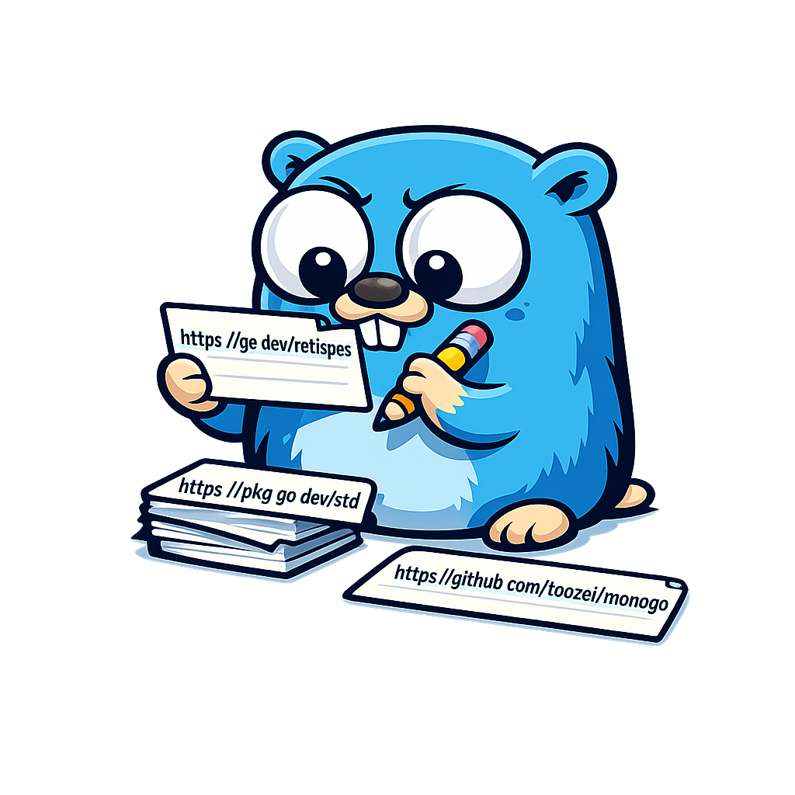

# url2anki




Generate Anki flashcards from a URL

## Usage

```sh
url2anki \
  --url 'https://example.com/cards' \
  --question-selector '.question' \
  --answer-selector '.answer' \
  --output-file cards.csv
```

You can also set the URL, selectors, and output file with
`URL2ANKI_URL`, `URL2ANKI_QUESTION_SELECTOR`, `URL2ANKI_ANSWER_SELECTOR`,
and `URL2ANKI_OUTPUT_FILE`. Network requests default to a 30-second timeout
and a 10 MiB response limit; override them with `--http-timeout` and
`--max-response-bytes` (or the matching `URL2ANKI_*` environment variables).

For a one-shot Compose run, set the URL and selector variables and run:

```sh
mkdir -p output
URL2ANKI_URL='https://example.com/cards' \
URL2ANKI_QUESTION_SELECTOR='.question' \
URL2ANKI_ANSWER_SELECTOR='.answer' \
URL2ANKI_OUTPUT_DIR="$PWD/output" \
URL2ANKI_UID="$(id -u)" \
URL2ANKI_GID="$(id -g)" \
docker compose -f apps/url2anki/docker-compose.yml up --abort-on-container-exit
```

The UID and GID settings keep the container nonroot and permit writes to the host-owned bind mount.
The app writes the generated deck to
`./output/anki_cards.csv`.

## changes required to update golang version
- `make update-golang-version`
